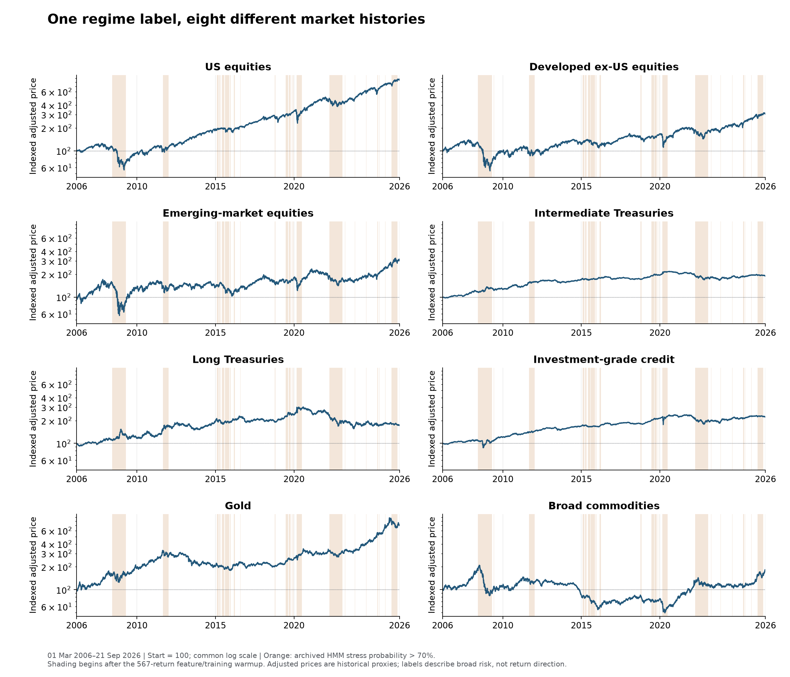
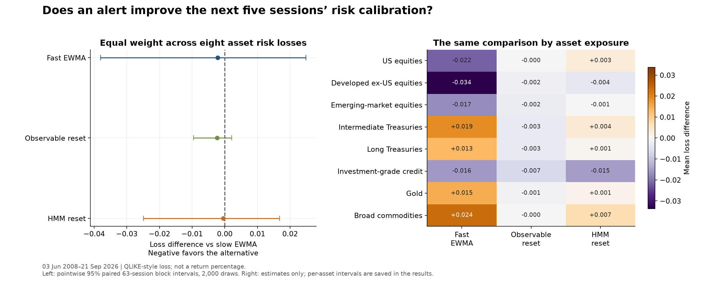

# Market regimes for faster research decisions

**Recognize a changing market, understand what changed, and decide what to recalibrate.**
A regime model can help a researcher shorten a calibration window, revisit correlations,
separate stress episodes, or test whether a model still describes its inputs. Predicting
a profitable trade is only one possible use.

This project combines immediate recognition, delayed confirmation and retrospective
interpretation using a feature-based HMM across **US and international equities, Treasuries, corporate credit,
gold and commodities**. The historical study spans **March 2006–21 September 2026**.
Charts use asset names so the economic picture comes before the tickers.

## Explore the research

| Research question | Read and inspect |
| --- | --- |
| What kind of regime has changed: risk, direction, or dependence? | [Three complementary lenses](docs/01-methods.md) |
| How did the signals behave in 2008–09, 2020, 2022 and 2025? | [Historical replay lab](docs/03-historical-replays.md) |
| Does a prompt alert improve the next calibration? | [Backtest, benchmarks and results](docs/02-results.md) |
| What should I actually do after an alert? | [Researcher's calibration playbook](docs/04-calibration-playbook.md) |
| How much does waiting five or twenty sessions change the description? | [Delayed labels and revisions](docs/02-results.md#allowing-a-short-delay-changes-the-label) |
| Where are the calculations and all figures? | [Executed research notebook](study.ipynb) |

## What a researcher gains

- A persistent map: labels change on **3.2%** of sessions,
  versus **55.3%** for the daily-return HMM.
- A dated review process: **26 confirmed HMM alerts**, with event replays
  showing what had already happened when each alert became available.
- A deliberate hindsight option: five- and twenty-session revised labels for event
  studies and calibration samples, alongside their original real-time descriptions.
- An actual calibration backtest: keep continuous risk updating in view, because a
  more stable regime map has not established better risk forecasts.

## The concrete experiment

Each confirmed alert resets a risk estimator to the latest 20 sessions and makes it
adapt faster for one month. Compare this with continuously slow and fast updating.
Score the following five sessions across eight assets, alongside review frequency,
missed reference episodes and the effect of delayed labels.

Across **4,600 matched forecast dates**, the feature-HMM reset's mean
loss difference versus slow EWMA is **-0.0005 (95% interval [-0.0249, +0.0167])**. Its advantage is
negligible and uncertain. The [results chapter](docs/02-results.md) shows the full
comparisons with fast updating, the raw-return model and direct state forecasts.

The HMM rule produces **1.42 review alerts per year**;
the conservative observable rule produces **0.05**.
The feature-based HMM describes smoothed risk levels and stock–bond dependence;
the raw-return HMM is retained as a benchmark. Five-session delayed labels revise **8.5%** of
original classifications. The result should be read alongside its interval, subperiods and state-count sensitivity. The observable threshold is too
conservative for a general early-warning role: it produces just one historical alert.

## Read the evidence in the right time frame

A label available at today's close can prompt a review. A label confirmed five sessions
later can improve an event study or a calibration sample. A full-history map can organize
past markets. All three are useful; the notebook shows the waiting time rather than
silently treating every label as an immediate forecast.

This is a retrospective calibration backtest on revised adjusted prices and a fixed
surviving ETF universe. It does not claim pristine out-of-sample validation, executable
strategy returns or known true regime dates. The previous narrow SPY forecast comparison
remains [preserved at its original revision](https://github.com/QuhiQuhihi/regime_model/tree/4c0164ea5a114d865b45bd4b48f40ce72954a7c4);
its inconclusive result is not erased by this broader research question.

[Reproduction and input access](docs/05-reproduction.md) · [Sources](research/SOURCES.md) ·
[Protocol](research/PROTOCOL.md) · [Publication boundaries](PUBLICATION.md).
