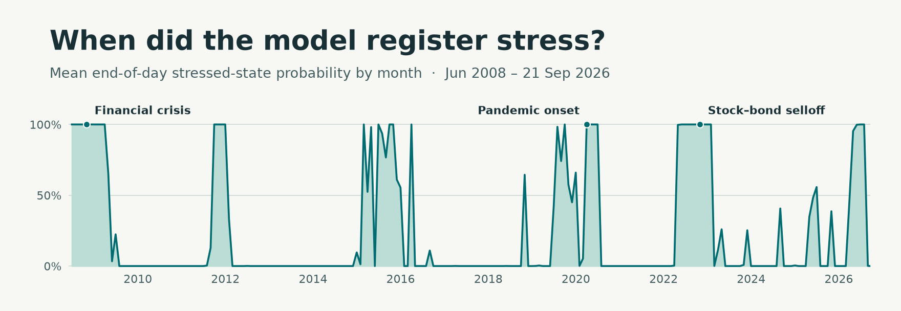
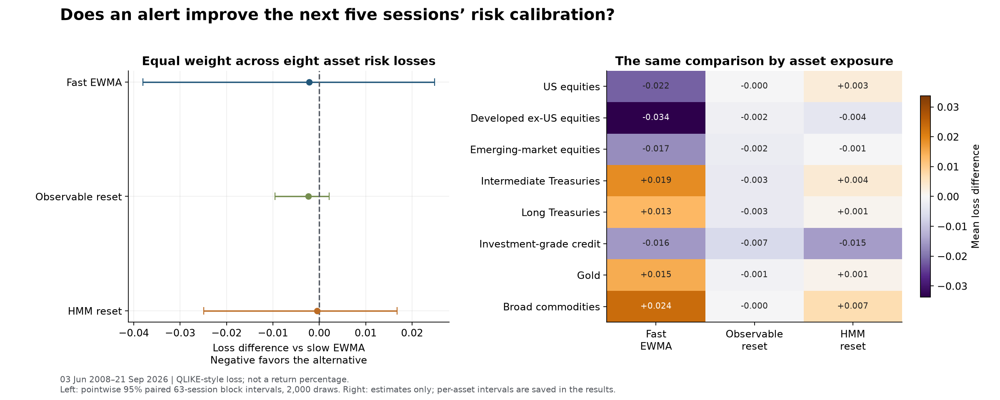

# Detecting market regimes with a hidden Markov model

At each market close, a three-state Gaussian hidden Markov model (HMM) uses returns
from eight ETFs to estimate the probability of a **quiet, active, or stressed** market. Can those
probabilities tell a researcher when to recalibrate risk?

Feeding the model risk levels and stock–bond dependence cut the share of sessions
with a label change from **55.3%** with daily returns to
**3.2%**. The steadier signal triggered
**26 reviews**. Resetting risk estimates at those
reviews had little effect on average forecast loss.

In February 2020 the model assigned about 5% probability to stress on average.
In March that average rose to nearly 100%. The chart summarizes daily estimates
available at each close. [Monthly data](research/results/practical/monthly_monitor.csv) · [Daily replay examples](docs/03-historical-replays.md)

## How the model assigns a regime

**1. Measure risk and dependence.** Let $r_t$ be the vector of daily returns for
SPY, EFA, EEM, IEF, TLT, LQD, GLD, and DBC. Update the matrix of return second
moments with an exponentially weighted moving average (EWMA).

$$
M_t(\lambda)=\lambda M_{t-1}(\lambda)+(1-\lambda)r_t r_t^\top
$$

With $\lambda=0.90$, take half the log of the mean diagonal entry within each
group to get four risk features (equities, Treasuries, credit, and real assets).
With $\lambda=0.97$, divide the SPY–TLT cross-moment by the product of their
root-mean-square returns, clip to $\pm 0.95$, and apply the Fisher transform. That gives the fifth feature.

**2. Fit three states and update them at each close.** Each month, fit a
diagonal-Gaussian HMM on the latest 504 feature observations. Standardize inputs
using that window and rank the states by their mean standardized level across the
four risk features. For today's standardized vector $x_t$, the filtered probability is

$$
\alpha_t(j) \propto \mathcal{N}(x_t\mid\mu_j,D_j)\sum_{i=1}^3 \alpha_{t-1}(i) A_{ij}
$$

$A_{ij}$ is the fitted probability of moving from state $i$ to state $j$.
The Gaussian density measures how well today's features fit state $j$.
Normalize across the three states and use the most probable one as the day's label.
[Feature construction and replay code](research/feature_regimes.py)

**3. Turn a stress signal into a review.** Two consecutive closes above 70% stressed
probability trigger a reset to the mean of the latest 20 daily return outer products.
For the next 21 updates, use fast EWMA (0.90), then resume slow EWMA (0.97).
Another alert requires the signal to first fall to 70% or below and at least 21
sessions to pass since the previous alert. [Alert and calibration code](research/practical_models.py)

## Did the reset improve the next five sessions' risk estimate?

Across **4,600 matched forecast dates**, the reset changed mean loss by
**-0.0005** versus continuous slow EWMA. Its 95% interval
**[-0.0249, +0.0167]** spans zero. The data are consistent
with either a modest improvement or a modest deterioration in calibration.

For each asset, score the second-moment forecast $v$ against the next five sessions'
mean squared return $y$ using $L(v,y)=\log(v)+y/v$. Average the loss equally across
assets. Negative differences favor the alternative rule. Intervals use 2,000 paired
block-bootstrap draws with 63-session blocks. [Result table](research/results/practical/calibration_comparison.csv)

The retrospective sample uses revised adjusted prices for eight surviving ETFs from
March 2006 through 21 September 2026. The feature design followed inspection of
the daily-return model on this same history. [Study protocol](research/PROTOCOL.md) · [Data sources](research/SOURCES.md) · [Publication notes](PUBLICATION.md)

[Executed notebook](study.ipynb) · [Methods](docs/01-methods.md) · [Full results](docs/02-results.md) · [Calibration playbook](docs/04-calibration-playbook.md) · [Reproduce the study](docs/05-reproduction.md)
