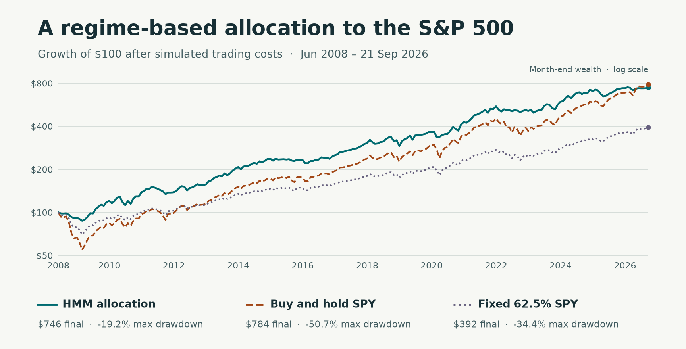

# Market regimes and the S&P 500

What happened to a stock portfolio that cut its exposure when markets looked stressed? This 18-year
backtest uses a three-state hidden Markov model (HMM) across eight ETFs to size a
position in **SPY**, the ETF tracking the S&P 500.

Blue, gold, and rose bands mark the model’s **quiet**, **active**, and **stressed**
classifications at each daily close. For example,
the HMM switched from active to stressed on 28 February 2020 and back to active
on 1 July.

**The regime allocation gave up some growth for a shallower drawdown.**
An initial \$100 grew to **\$746** with the model and
**\$784** with buy-and-hold SPY. The largest peak-to-trough
loss, measured at daily closes, was **19.2%** for the model
and **50.7%** for buy-and-hold.

**What was traded.** Each close's filtered stress probability $p_t$ sets a target
SPY weight of $1-0.75p_t$, ranging from 25% to 100%. Trade at the following close
and earn the new position's return from then on. All three portfolios start in cash,
use adjusted SPY prices, earn 0% on cash, and pay 5 basis points per dollar traded,
including entry. The fixed mix rebalances to 62.5% SPY daily. Curves show month-end
wealth plus the final session. [Monthly wealth](docs/figures/spy-wealth.csv) · [Daily-based performance summary](docs/figures/spy-performance.csv)

This historical simulation applies the earlier allocation rule to a model developed
on the same history. Its portfolio results are exploratory. [Allocation rule](research/protocol_versions/forecast_20260919.md) · [Backtest code](research/landing_backtest.py)

## How the model assigns a regime

**1. Measure risk and dependence.** Let $r_t$ be the vector of daily returns for
SPY, EFA, EEM, IEF, TLT, LQD, GLD, and DBC. Update the matrix of return second
moments with an exponentially weighted moving average (EWMA).

$$
M_t(\lambda)=\lambda M_{t-1}(\lambda)+(1-\lambda)r_t r_t^\top
$$

With $\lambda=0.90$, take half the log of the mean diagonal entry within each
group to get four risk features (equities, Treasuries, credit, and real assets).
With $\lambda=0.97$, divide the SPY–TLT cross-moment by the product of their
root-mean-square returns, clip to $\pm 0.95$, and apply the Fisher transform. That gives the fifth feature.

**2. Fit three states and update them at each close.** Each month, fit a
diagonal-Gaussian HMM on the latest 504 feature observations. Standardize inputs
using that window and rank the states by their mean standardized level across the
four risk features. For today's standardized vector $x_t$, the filtered probability is

$$
\alpha_t(j) \propto \mathcal{N}(x_t\mid\mu_j,D_j)\sum_{i=1}^3 \alpha_{t-1}(i) A_{ij}
$$

$A_{ij}$ is the fitted probability of moving from state $i$ to state $j$.
The Gaussian density measures how well today's features fit state $j$.
Normalize across the three states and use the most probable one as the day's label.
[Feature construction and replay code](research/feature_regimes.py)

Across the full replay, the feature model switched labels on
**3.2%** of sessions versus **55.3%**
for the daily-return HMM. [Stress probability over time](docs/figures/stress-history.png) · [Daily replay examples](docs/03-historical-replays.md)

**3. Test a separate risk-calibration rule.** Two consecutive closes above 70% stressed
probability trigger a reset to the mean of the latest 20 daily return outer products.
For the next 21 updates, use fast EWMA (0.90), then resume slow EWMA (0.97).
Another alert requires the signal to first fall to 70% or below and at least 21
sessions to pass since the previous alert. [Alert and calibration code](research/practical_models.py)

## Did the reset improve the next five sessions' risk estimate?

The model triggered **26 resets**. Across **4,600 matched forecast dates**, the reset changed mean loss by
**-0.0005** versus continuous slow EWMA. Its 95% interval
**[-0.0249, +0.0167]** spans zero. The data are consistent
with either a modest improvement or a modest deterioration in calibration.

For each asset, score the second-moment forecast $v$ against the next five sessions'
mean squared return $y$ using $L(v,y)=\log(v)+y/v$. Average the loss equally across
assets. Negative differences favor the alternative rule. Intervals use 2,000 paired
block-bootstrap draws with 63-session blocks. [Result table](research/results/practical/calibration_comparison.csv)

The retrospective sample uses revised adjusted prices for eight surviving ETFs from
March 2006 through 21 September 2026. The feature design followed inspection of
the daily-return model on this same history. [Study protocol](research/PROTOCOL.md) · [Data sources](research/SOURCES.md) · [Publication notes](PUBLICATION.md)

[Executed notebook](study.ipynb) · [Methods](docs/01-methods.md) · [Full results](docs/02-results.md) · [Calibration playbook](docs/04-calibration-playbook.md) · [Reproduce the study](docs/05-reproduction.md)
