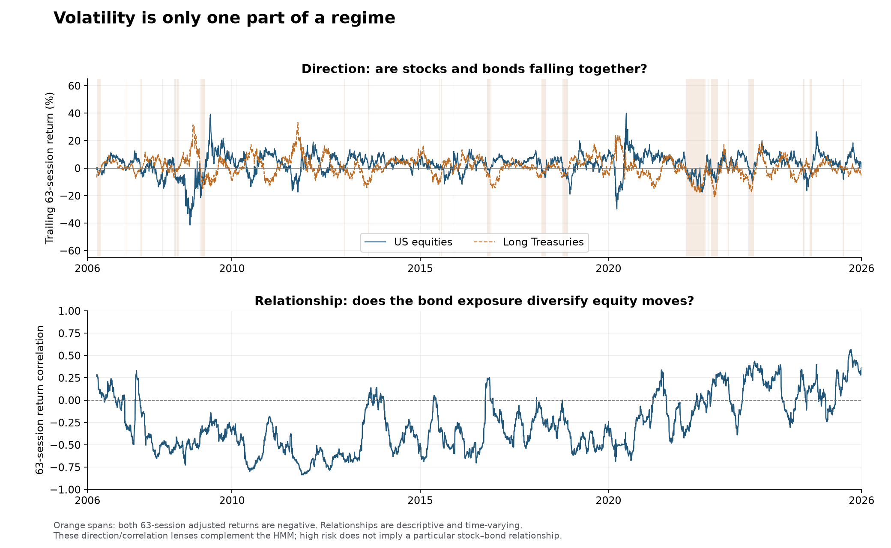

# A regime is a reason to revisit a model

A researcher rarely needs the exact date of an unobservable structural break. The
more immediate questions are whether the current calibration still represents the
market, which exposures changed, and whether the evidence justifies a review now.
This project treats regime modeling as a way to answer those questions.

## Read risk, direction and dependence together

The same high-volatility label can cover rising commodities, falling equities, or a
market in which both stocks and bonds decline. A three-state model cannot compress
all these distinctions into one useful word. The research therefore combines:

| Lens | What it describes | Research use |
| --- | --- | --- |
| Broad risk state | Quiet, active or stressed return distributions across eight assets | Revisit volatility estimates and scenario severity |
| Direction | Trailing quarterly equity and Treasury returns | Distinguish defensive bonds from simultaneous stock/bond weakness |
| Dependence | Rolling equity–bond correlation | Revisit hedge assumptions and covariance calibration |

These are measured descriptions, not economic causes. A change in correlation does
not tell us why the relationship changed; it does tell us which model assumption
needs inspection. A low-volatility state need not mean attractive expected returns.

## The market panel

| Exposure | Historical proxy | What the label leaves out |
| --- | --- | --- |
| US equities | SPY | Large-cap US equity exposure |
| Developed ex-US equities | EFA | USD returns include currency and asynchronous underlying closes |
| Emerging-market equities | EEM | A changing country/sector composition |
| Intermediate Treasuries | IEF | Duration exposure rather than a cash rate |
| Long Treasuries | TLT | Greater duration sensitivity |
| Investment-grade credit | LQD | Both rates and credit-spread exposure; not pure credit risk |
| Gold | GLD | A specific fund's adjusted-price proxy |
| Broad commodities | DBC | Futures exposure and roll effects, not a spot commodity basket |

All eight use the same observed US sessions from March 2006 through 21 September 2026.
The common history starts after the newest fund's inception. Prices are adjusted by
the provider; splits/distributions are not added again. The final cutoff avoids a
missing EFA session on 22 September. No interpolated or carried-forward prices are used.

## Immediate recognition: a probabilistic state

The maintained HMM reads five features: fast log-risk levels for equities,
Treasuries, credit and real assets, plus a slower equity–bond dependence estimate.
These features describe a changing market distribution rather than the sign of one
noisy return. Risk levels use EWMA decay .90; the dependence proxy uses .97. The
[feature design](../research/feature_design_20260924.md) states the exact transformations.

Every month, fit three Gaussian states on the last 504 feature observations, with
training-only standardization. A 63-return initialization gives all calibration
comparisons a common 567-return warmup. Rank states by their average standardized
log-risk level: quiet, active and stressed. The first daily-return HMM remains a
benchmark; its frequent label changes motivated this exploratory representation change.

For state j, the end-of-day update is:

$$
\alpha_t(j)\propto f_j(r_t)\sum_i\alpha_{t-1}(i)A_{ij}.
$$

The transition matrix supplies persistence, while today's observation can move the
posterior immediately. State names follow the average fitted log-risk level
across the four asset groups: quiet, active and stressed. The ranking is recalculated at each refit;
these are relative risk labels, not permanent economic identities or recession calls.

A probability vector is more informative than its largest element. When two states
have similar probabilities, the researcher should inspect the transition rather than
treat the color of a chart as certainty. Normalized entropy ranges from zero for a
concentrated posterior to one for equal probabilities.

Training-smoothed state weights estimate conditional raw-return second moments.
The supporting HMM risk forecast averages those state-weighted second moments at horizons
one through five, using the corresponding powers of the fitted transition matrix.
It answers a forecasting question distinct from using the current state as a review
trigger. Failed refits retain the last valid model; the run records every failure.

## A deliberate use of hindsight

Full-history smoothing is useful for organizing a crisis, describing state-dependent
relationships and selecting examples to study. It need not pass a trading backtest to
serve those purposes. Its limitation is specific: the final historical label cannot
be credited with triggering a decision before that label existed.

Fixed-lag smoothing offers an intermediate choice. At today's close, revisit the state
five or twenty sessions ago using all observations now available. Extra observations
can clarify an ambiguous transition; monthly parameter refits can also change it.
Keep two dates: **the day described** and **the day the revised estimate is available**.

This accommodates the researcher's willingness to accept a revised history. The
[revision chart](02-results.md#allowing-a-short-delay-changes-the-label) measures what
that choice changes. Full-history agreement measures similarity to a final description,
not accuracy against a known true state.

## A defined action after an alert

A high state is a level; a review alert is an event. The HMM alert requires stressed
probability above 70% for two observations. The observable alert requires the median
fast/slow volatility ratio across eight assets above 1.5 twice. Both must re-arm after
falling below their threshold, and cannot produce reviews less than 21 sessions apart.
The 1.5 ratio is deliberately conservative; its looser 1.3 alternative is reported.

For the backtest, a review has a specific consequence: replace the current second-moment
matrix with the last 20 daily return outer products, then use faster exponential
updating for 21 sessions. This is a calibration policy, not a prediction that risky
assets must fall. The [playbook](04-calibration-playbook.md) explains how a researcher
can use the alert without automatically rebuilding every model.

The feature HMM includes a stock–bond dependence input, while the simple volatility
alarm cannot reliably recognize a pure correlation shift. The separate relationship
panel makes that distinction visible. The synthetic diagnostic specifically tests
the observable volatility detector, not the HMM's correlation sensitivity.

Smoothing the inputs trades some reaction speed for a more persistent description.
Overlapping features also weaken the HMM's conditional-independence approximation.
Its posterior can be overly concentrated: a 99% model-implied probability is not a
validated 99% chance that an objectively true economic regime exists.

[Results](02-results.md) · [Full settings](../research/PROTOCOL.md) · [Sources](../research/SOURCES.md).
