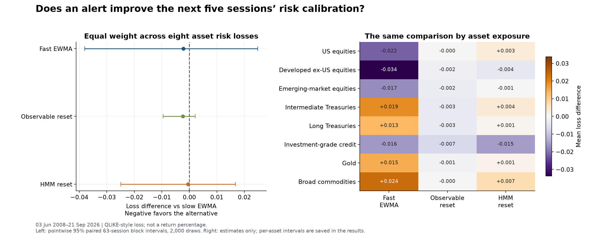
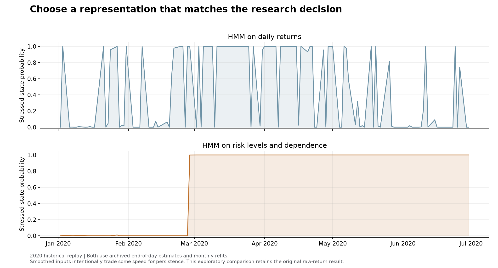
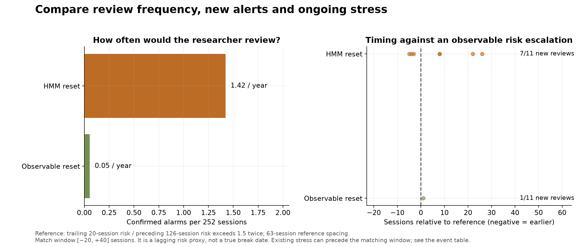
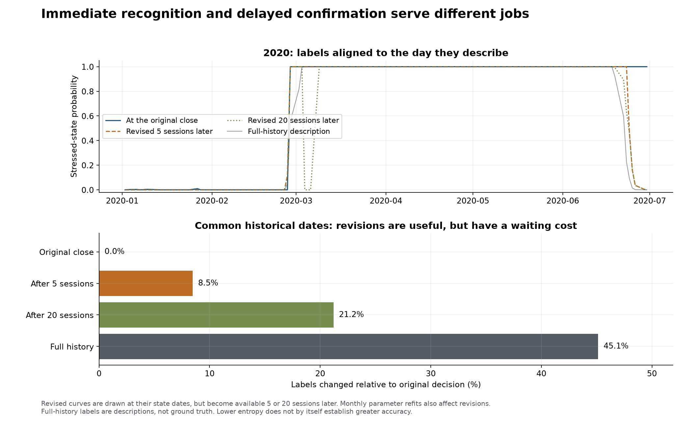
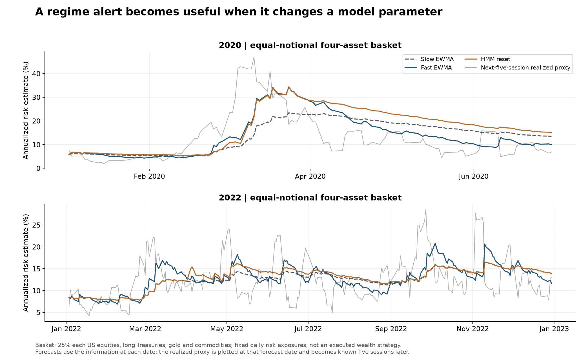

# What changes when regimes become a research tool?

Across eight asset exposures and 4,600 matched forecast dates, the HMM-triggered reset has mean risk-loss difference **-0.0005 (95% interval [-0.0249, +0.0167])** versus slow EWMA. The observable reset gives **-0.0023 (95% interval [-0.0096, +0.0021])**; continuously fast EWMA gives **-0.0022 (95% interval [-0.0380, +0.0249])**. Negative favors the alternative. These are calibration losses, not investment returns.

## Calibration is the practical test

An alert changes the input to a research decision: replace the slow risk estimate with
one based on the latest 20 sessions, then update it faster for the next 21 sessions.
The test scores the following five sessions, so an attractive retrospective label
cannot improve a forecast that was already frozen.

| Calibration rule | Loss difference vs slow EWMA | Pointwise 95% interval |
| --- | --- | --- |
| Fast EWMA | -0.0022 | [-0.0380, +0.0249] |
| Observable reset | -0.0023 | [-0.0096, +0.0021] |
| HMM reset | -0.0005 | [-0.0249, +0.0167] |
| HMM state forecast | +0.1889 | [+0.0607, +0.4127] |
| Raw-return HMM reset | -0.0137 | [-0.0449, +0.0076] |

The primary targets are eight individual asset second moments, weighted equally in the
loss. This does not give equities more importance because their raw volatility is larger.
The supporting basket uses quarter weights in US equities, long Treasuries, gold and
commodities; its risk includes their correlations. Loss is log(v) + realized r² / v,
with the five-session mean squared return as the target.

Intervals use paired 63-session circular blocks and 2,000 draws. Overlapping five-day
targets, cross-asset dependence and each day's common outcomes are preserved by the
paired sampling. The intervals condition on fitted paths; they do not remove model
selection, revised-data or familiar-history uncertainty. Two primary alert contrasts
have pointwise intervals, without familywise coverage.

## Which representation gives a useful research picture?

| Model inputs | Sessions with a label change | Review alerts | Reviews per year |
| --- | --- | --- | --- |
| Daily returns | 55.3% | 78 | 4.27 |
| Risk and dependence features | 3.2% | 26 | 1.42 |

The original daily-return HMM and the feature-based HMM are both retained. The
feature version describes recent risk levels and equity–bond dependence; it was
introduced after inspecting the first model's rapid label changes. This is an
explicit exploratory amendment, not an independent validation sample. Smoother labels
are useful for interpretation but do not, by themselves, establish better forecasts.
The raw-return reset is re-scored over the same dates as the feature-based policy.

The result supports a specific workflow: use the more persistent map to organize
research and review scenarios, while maintaining continuous risk updates. The
feature-based reset changes the average calibration loss by very little, with an
interval spanning zero. Its direct state-moment forecast is worse than the slow
baseline under this specification. A useful descriptive state is not automatically
the best forecasting model.

## A fast response has an operating burden

| Alert | Alerts | Per year | Time in reset/fast mode | Reference episodes matched |
| --- | --- | --- | --- | --- |
| Observable reset | 1 | 0.05 | 0.5% | 1/11 |
| HMM reset | 26 | 1.42 | 12.4% | 7/11 |

The conservative observable threshold generates only **one alert in the entire replay**.
Its quietness is not evidence of reliable detection: the synthetic primary check
misses even the stipulated volatility doubling. The predeclared 1.3 sensitivity gives
six historical alerts; the 1.7 sensitivity gives none. These outcomes are shown rather
than silently replacing the weak primary threshold with a more favorable one.

In a prolonged stressed state, no new alert may be issued because the rule has not
re-armed. For example, the feature HMM is already stressed from its first June 2008
review through the September escalation. The event table records high-state status
separately, so the new-alert match rate is not presented as true-regime detection accuracy.

The reference is an observable escalation in recent volatility, not a known true
regime boundary. A negative lag means earlier than that reference; unmatched alerts
can reflect another sort of change and are not automatically false alarms. The
[complete event table](../research/results/practical/episode_timing.csv) retains misses.

## Allowing a short delay changes the label

On common available dates, **8.5%** of
labels differ after five sessions and **21.2%**
after twenty. The full-history map differs on **45.1%**.
These revisions can help research interpretation. They also show why the date a label
becomes available belongs beside the date it describes.

## Inspect the contrasts, not just an average

The [subperiod table](../research/results/practical/subperiods.csv) covers 2008–2014,
2015–2019, 2020–2023 and 2024–latest. [Sensitivity results](../research/results/practical/sensitivity.csv)
retain two-state/three-state fits, a second seed and both tighter and looser alert
thresholds. None replaces the original specification. Per-asset intervals are in
[asset_comparison.csv](../research/results/practical/asset_comparison.csv).

## Latest historical research snapshot

As of **2026-09-21**, the broad HMM label is **Active**, stressed-state
probability **0.0%**, and normalized uncertainty **0.00**.
The fast/slow risk ratio is **0.97**, while the trailing
63-session US-equity/long-Treasury correlation is **+0.36**.
This is the endpoint of the recorded historical replay, not a live signal service.
[The snapshot](../research/results/practical/latest_monitor.json) contains the full
probability vector, asset-direction context and last review dates.

[Methods](01-methods.md) · [Historical event lab](03-historical-replays.md) ·
[Researcher's playbook](04-calibration-playbook.md) · [Exact protocol](../research/PROTOCOL.md).
