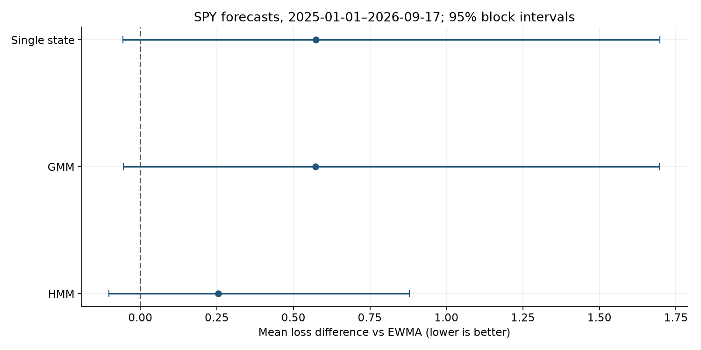
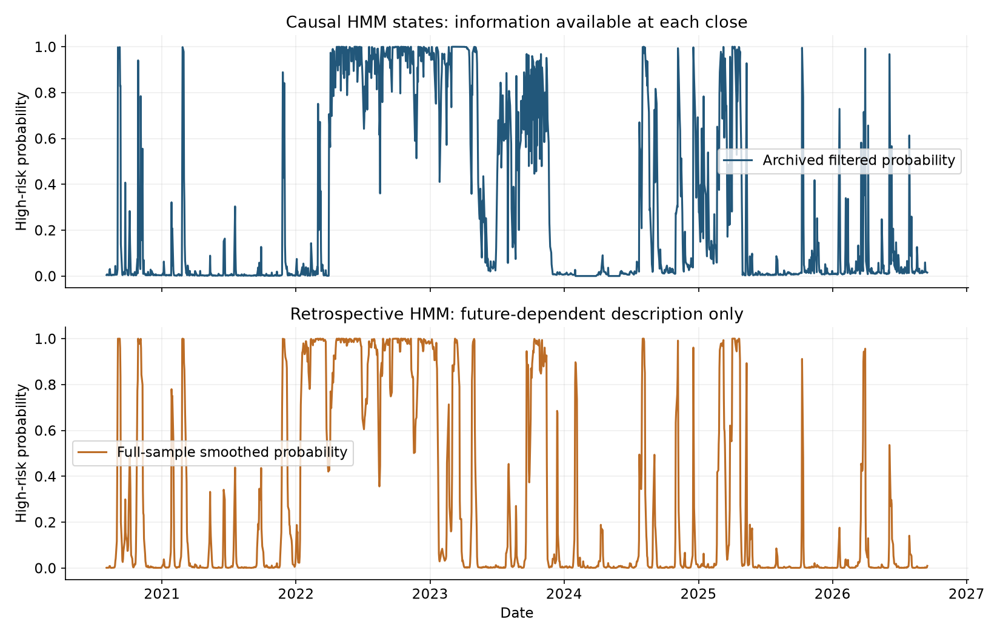

# Do market states improve risk forecasts?

Through 2026-09-17, the late-segment two-state HMM minus EWMA mean next-session risk loss is **+0.2539**, with paired 95% block interval **[-0.1024, +0.8795]**. Negative favors HMM. The result does not establish incremental forecasting value, and does not establish general regime-prediction ability.

## Forecast evidence

| period | model | n | mean_loss | mean_forecast | realized_to_predicted |
| --- | --- | --- | --- | --- | --- |
| late | EWMA | 428 | -8.31006 | 0.000118494 | 0.988801 |
| late | GMM | 428 | -7.73757 | 0.000100289 | 1.16829 |
| late | HMM | 428 | -8.05618 | 9.00073e-05 | 1.30175 |
| late | Single state | 428 | -7.73709 | 0.000100189 | 1.16946 |

The loss uses the same next-session squared SPY return for all models. Its absolute level is not a performance percentage. A GMM is an iid mixture; its current posterior is not a Markov next-state forecast. HMM decisions use forward filtering, not full-sample smoothing.

## Bounded sensitivity

| variant | estimate | lower95 | upper95 | block | draws | n | failed_hmm_refits | refits |
| --- | --- | --- | --- | --- | --- | --- | --- | --- |
| primary | 0.253878 | -0.102351 | 0.879465 | 21 | 2000 | 428 | 0 | 74 |
| three_states | 0.266082 | -0.120088 | 0.951861 | 21 | 2000 | 428 | 1 | 74 |
| seed41 | 0.248807 | -0.10677 | 0.880139 | 21 | 2000 | 428 | 0 | 74 |
| floor01 | 0.253897 | -0.102353 | 0.87955 | 21 | 2000 | 428 | 0 | 74 |
| spy_only | 0.293272 | -0.0978238 | 1.00043 | 21 | 2000 | 428 | 0 | 74 |

One primary HMM/EWMA comparison; these extra intervals are pointwise exploratory diagnostics, not independent confirmations. Failed fits use EWMA and are counted.

## Decisions after execution costs

| strategy | cagr | volatility | max_drawdown | annual_turnover | mean_risky_weight |
| --- | --- | --- | --- | --- | --- |
| EWMA target | 0.0736075 | 0.105281 | -0.120395 | 5.22185 | 0.731952 |
| HMM overlay | 0.141474 | 0.124193 | -0.112003 | 16.2087 | 0.886616 |
| Static 62.5% | 0.112192 | 0.107285 | -0.120658 | 0.414957 | 0.625 |

The overlay trades one close after the signal and first earns the following session. This delay differs from the one-step forecast target; lower exposure can explain safer returns. Zero cash accrual, closing fills, fixed surviving ETFs and revised adjusted closes limit investability.

## Description, detection and prediction

The synthetic null alarm rate is 0.0% across 50 runs. The variance-break example detects after the change in 100.0% of runs; conditional mean delay is 12.4 observations. These are constructed variance changes, not labeled market recessions. The simplified greedy splitter is not the complete optimized GGS algorithm.

Full-sample states revise historical labels using information unavailable then. This is useful historical organization but cannot substitute for the forecast comparison. No state is called a recession. Consult [methods](01-methods.md), [protocol](../research/PROTOCOL.md), [sources](../research/SOURCES.md), and [next experiment](../research/RESEARCH_AGENDA.md).
