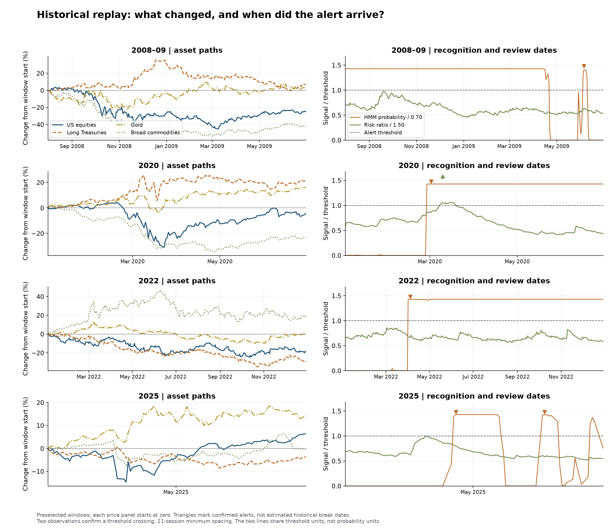
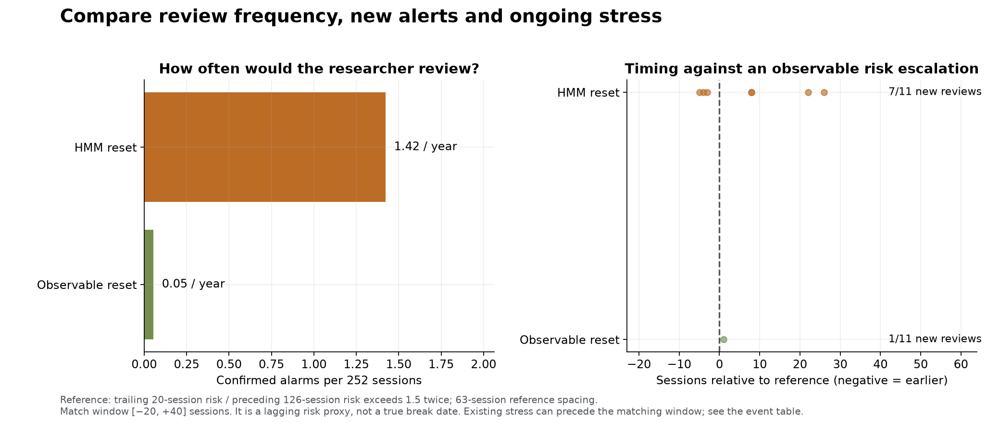

# Replay the change before judging the model

Start with what the assets actually did. US equities, long Treasuries, gold and
commodities can respond very differently inside the same broad risk state. Then
ask when the research process would have flagged the change and what it would have
done to the calibration.

The left panels show adjusted-price changes from each window's first observation.
The right panels show the information available at each close. Both signal curves
are divided by their own threshold: one means the threshold has been reached. The
triangles are confirmed **review dates**, not retrospectively estimated break dates.

## Four windows, four useful questions

The windows were chosen before the new numerical evaluation. They are familiar
historical examples, so their apparent explanatory power is not independent validation.

- **2008–09:** did an elevated-risk state remain useful as different exposures diverged,
  and did the review rule keep issuing redundant alerts during persistent stress?
- **2020:** how far did prices move before confirmation, and how quickly did the revised
  risk estimate respond? The first fall is observable before a model can confirm a pattern.
- **2022:** did the stock–bond relationship require attention even when a single broad
  volatility label provided an incomplete account of the change?
- **2025:** did a shorter disturbance generate a useful review or a temporary reset that
  remained active after conditions settled?

These questions are meant to be read from the plotted observations and saved dates.
They do not assume that a named calendar episode supplies the true latent change point.
The [asset atlas](../research/figures/practical/market_atlas.png) gives the full-history
context, including intervals outside these selected windows.

## How early is early?

An empirical timing reference is the first confirmed crossing of recent 20-session
volatility above 1.5 times volatility in the preceding 126 sessions, aggregated by the
median across assets. References are separated by at least 63 sessions. For each
reference, the study looks for the first review alert from 20 sessions before to 40
sessions after it. It keeps references with no matching alert.

An alert ten days before this reference did not necessarily predict a break ten days
in advance. The reference itself uses trailing observations and can be slow. It also
shares inputs with the simple volatility detector. Its value is a common empirical
clock, while subsequent calibration loss is the more consequential comparison.

A missing new review is not always a missed risk state. In this replay, the feature
HMM already assigns high stress at the first review on 3 June 2008 and remains high
through the later September escalation. The rule does not issue another alert without
re-arming. The event table therefore records both new-alarm matches and whether the
HMM was already in its high-stress state at the reference date. This distinction matters
when deciding whether to keep recalibrating inside a prolonged regime.

The [event table](../research/results/practical/episode_timing.csv) reports each match,
lag and miss. [Review burden](../research/results/practical/review_burden.csv) retains
unmatched alarms. Without known true historical boundaries, calling every unmatched
alarm false would overstate what the data can tell us.

## Known changes as a separate diagnostic

The notebook also checks the observable detector on stationary paths, an abrupt
volatility doubling, a gradual rise, and a pure correlation shift. Each case uses
100 independently generated paths with a known change location. Report null and
pre-change alarms, the fraction detected within 60 sessions and delay conditional
on detection. A short conditional delay alongside a low hit rate is not reliable
rapid detection.

[The synthetic summary](../research/results/practical/synthetic_summary.csv) is an
algorithm diagnostic. It does not supply missing historical observations, establish
real-market false-positive rates or validate a recession detector.

[Calibration outcomes](02-results.md) · [Researcher's playbook](04-calibration-playbook.md).
