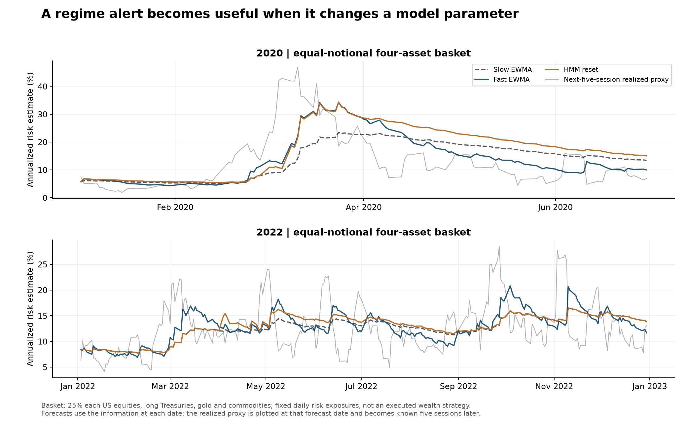

# From a regime alert to a research decision

The alert is an invitation to inspect a model assumption. Its value depends on whether
that inspection changes a relevant parameter, scenario or research sample—not on how
convincingly the chart colors a historical crisis.

## At the current close: diagnose the change

Read the state probabilities alongside asset directions and the stock–bond correlation.
A high stress probability with broad volatility escalation points toward risk-scale
calibration. Stocks and bonds declining together calls for examination of hedge and
covariance assumptions. A noisy posterior with no broad change may warrant observation
before a model reset.

The [latest recorded snapshot](../research/results/practical/latest_monitor.json)
retains the whole probability vector, uncertainty, recent asset returns, the correlation
estimate and the last alert dates. It is a dated research snapshot; refreshing data and
rerunning the study produces another inspectable version.

## Recalibrate only what the evidence challenges

| Observed change | Useful research response | What would justify it |
| --- | --- | --- |
| Broad increase in realized risk | Compare shorter-window and faster-decay risk estimates | Better subsequent calibration, with an acceptable review burden |
| Different stock–bond dependence | Re-estimate covariance and stress the hedge relationship | A persistent relationship change across plausible windows |
| Different return direction with similar risk | Inspect model residuals, factor exposures and directional features | Evidence the forecasting model's inputs or errors changed |
| Ambiguous transition | Retain a mixture of calibrations rather than a hard state switch | Uncertain probabilities and sensitivity to nearby refits |
| Clearer state after a short delay | Revise an event-study window or condition a research sample | Explicitly recorded label and availability dates |

The completed backtest implements the first response. The other rows explain sensible
uses of the diagnostics; they are not claimed as separately executed alpha-model or
hedging strategies. A regime model is not a universal instruction to discard older data.

## The tested reset policy

Suppose an alert is confirmed at close t. Form a new risk matrix from the last twenty
daily return outer products, including t. Apply 10% diagonal shrinkage when producing
the forecast. For the next twenty-one updates, use the fast exponential decay of .90;
afterwards return to .97 unless another eligible alert resets the process.

The observation at t can influence the newly calibrated model. Outcomes used to score
it begin at t+1. This is exactly the practical sequence a researcher needs: notice a
change, recalibrate with what is now available, and evaluate what happens afterwards.

The four-asset basket is a fixed risk exposure, not a continuously rebalanced investable
strategy with a claimed net return. No transaction-cost assumption is needed to score
a model's risk estimate; execution and costs would be essential before translating
that estimate into a portfolio trading claim.

## Use a delayed map for a different job

After five or twenty sessions, revisit the event window with the delayed posterior.
That can support calibration-sample selection, model diagnostics or a retrospective
scenario library. Preserve the original alert date: a revised change label is not a
reason to erase the delay the researcher actually faced.

A full-sample map can go further and organize the entire history. Inspect its
[state fingerprints](../research/figures/practical/state_fingerprints.png), and use
appropriate labels such as conditional historical volatility. Do not infer expected
future returns from the sample that helped define the states.

## Decide whether the additional machinery earns its place

Compare alert-triggered resets with both slow and continuously fast updating. Examine
per-asset outcomes and subperiods, not only the average. Check how much changing the
probability or volatility threshold alters review frequency and results. The choice
can legitimately differ between a weekly research review and a high-frequency desk;
this study evaluates an end-of-day process.

The [results chapter](02-results.md) supplies those comparisons. Any more ambitious
choice—state-dependent alpha training, switching valuation models, automated hedge
changes—needs its own explicit action, benchmark and subsequent-outcome test.
